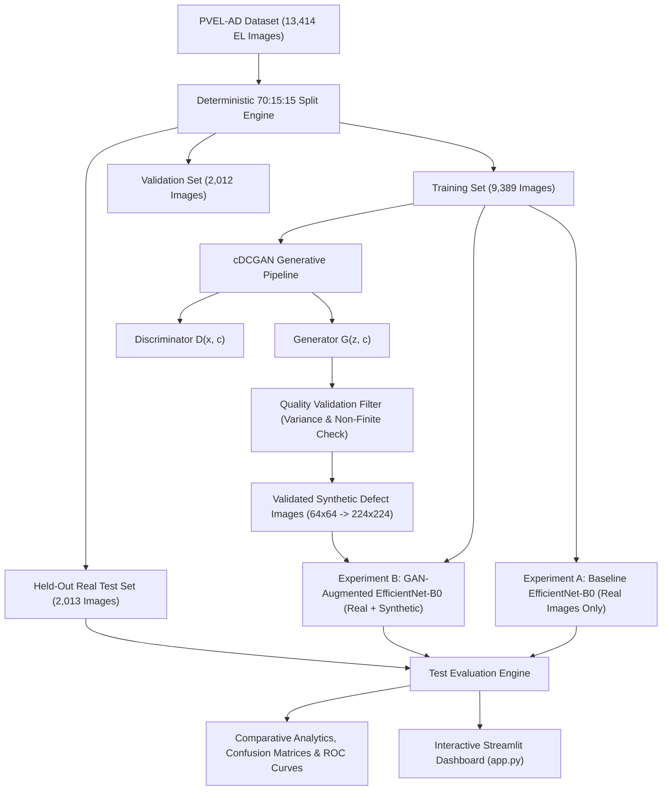

# SolarSentinel AI: GAN + EfficientNet-B0 for Solar Panel Defect Detection

[](https://pytorch.org)
[](https://streamlit.io)
[](https://python.org)
[](https://github.com)

**SolarSentinel AI** is an end-to-end deep learning and generative AI system for automated electroluminescence (EL) defect detection in photovoltaic (PV) solar panels. It addresses severe real-world class imbalance by combining a **Conditional Deep Convolutional Generative Adversarial Network (cDCGAN)** with a transfer-learning **EfficientNet-B0** multi-label classifier.

---

## 1. Project Abstract
Photovoltaic cell manufacturing and deployment suffer from low-frequency but catastrophic physical flaws (e.g., star cracks, broken contact fingers, wafer micro-cracks). Genuine electroluminescence (EL) datasets such as PVEL-AD contain tens of thousands of nominal cells, but less than 1% representation for critical failure modes. SolarSentinel AI implements a conditional generative adversarial framework that synthesizes class-conditioned defect variations to augment minority defect representation, followed by controlled benchmark evaluation against an ImageNet-pretrained EfficientNet-B0 on an untouched held-out real test set.

---

## 2. Problem Statement & Research Motivation
- **Severe Class Scarcity:** Defect categories such as `star_crack` (123 / 13,414) and `other_defect` (17 / 13,414) comprise negligible fractions of the total dataset.
- **Limits of Traditional Augmentation:** Geometric transformations (affine transforms, rotations) merely replicate existing patterns without synthesizing novel carrier recombination dark features.
- **Industrial Imperative:** High-speed PV module fabrication requires real-time sub-25ms classification with high defect recall to prevent hot-spot formation in operational utility-scale arrays.

---

## 3. System Architecture & Workflow



---

## 4. Deep Learning Architectures

### 4.1 Conditional DCGAN (cDCGAN)
- **Generator ($G$):** Accepts a 100-dimensional Gaussian noise vector $z \sim \mathcal{N}(0, I)$ concatenated with a 64-dimensional class condition embedding $c$. Projects the combined 164-dimensional representation into a $512 \times 4 \times 4$ spatial map, upsampling across four transposed convolutional layers with Batch Normalization and ReLU, culminating in a $64 \times 64 \times 3$ image with Tanh activation.
- **Discriminator ($D$):** Accepts a 3-channel RGB image concatenated with a $1 \times 64 \times 64$ spatial embedding plane (4 channels total). Downsamples through four strided convolutional layers with LeakyReLU ($\alpha = 0.2$) and Batch Normalization to output a real/fake probability logit.
- **Loss Formulation:** Binary Cross-Entropy with One-Sided Label Smoothing (real = 0.9, fake = 0.0) to stabilize discriminator gradients.

### 4.2 EfficientNet-B0 Classifier
- **Backbone:** EfficientNet-B0 with ImageNet pretrained transfer weights.
- **Classification Head:** Global Average Pooling $\to$ Dropout ($p=0.3$) $\to$ Linear(1280, 8).
- **Inference Activation:** Multi-label Sigmoid ($\sigma(z_i) \in [0, 1]$), evaluated independently per defect class against a calibrated threshold ($\tau = 0.5$).
- **Imbalance Handling:** `pos_weight` in `BCEWithLogitsLoss` calculated from training frequencies:
  $$w_c = \text{clip}\left(\frac{N - N_c}{N_c}, 1.0, 20.0\right)$$

---

## 5. Dataset Organization & Splits
- **Source Dataset:** PVEL-AD (Photovoltaic Electroluminescence Anomaly Detection benchmark).
- **Target Categories (8 Classes):** `crack`, `finger`, `black_core`, `thick_line`, `star_crack`, `other_defect`, `good`, `material`.
- **Partition Ratio:** 70% Train (9,389) | 15% Validation (2,012) | 15% Held-Out Test (2,013).
- **Zero-Leakage Assurance:** Synthetic images generated by cDCGAN are strictly restricted to Experiment B's training loader. Validation and test sets are exclusively genuine real EL images.

---

## 6. Installation & Environment Setup

### Prerequisites
- Python 3.10+ (Tested on Python 3.12)
- PyTorch 2.2+ (CPU or CUDA GPU)

```bash
# 1. Clone or navigate to the repository
cd "SolarSentinel AI"

# 2. Install dependencies
pip install -r requirements.txt
```

---

## 7. Step-by-Step Execution Guide

### Option 1: Master Pipeline (Recommended)
Orchestrates environment checks, splitting, GAN training, synthetic generation, classifier training, evaluation, comparison, and tests in one command:
```bash
python run_pipeline.py
```
*For a rapid functional verification run, use the smoke-test flag:*
```bash
python run_pipeline.py --smoke-test
```

### Option 2: Modular Execution
Each phase can be executed independently for evaluation demonstrations:

```bash
# 1. Train Conditional DCGAN
python src/train_gan.py --epochs 15 --batch-size 32

# 2. Generate and Quality-Filter Synthetic Defect Samples
python src/generate_images.py --num-per-class 30

# 3. Train Baseline Classifier (Exp A)
python src/train_classifier.py --mode baseline --epochs 5

# 4. Train GAN-Augmented Classifier (Exp B)
python src/train_classifier.py --mode augmented --epochs 5

# 5. Evaluate on Held-Out Test Set
python src/evaluate.py --checkpoint checkpoints/baseline_efficientnet_b0.pth --name Baseline
python src/evaluate.py --checkpoint checkpoints/gan_augmented_efficientnet_b0.pth --name GAN_Augmented

# 6. Generate Comparative Analytics & Delta Metrics
python src/compare_models.py

# 7. Run Automated Verification Tests
python run_tests.py
```

---

## 8. Launching the Web Application
Start the interactive Streamlit dashboard:
```bash
streamlit run app.py
```

### Application Features:
1. **📊 Executive Dashboard:** System architecture, dataset distribution, and hardware indicators.
2. **🔍 Defect Inference:** Upload real EL images or select from sample gallery; view multi-label probabilities, diagnosis, and millisecond latency meter.
3. **🎨 cGAN Generation Studio:** Select defect condition, adjust random seed, and generate on-demand synthetic EL samples with mandatory **Synthetic** watermarking.
4. **⚖️ Model Comparison:** Side-by-side empirical performance tables, delta F1 and recall bar charts.
5. **📈 Evaluation Visualizations:** Confusion matrix grids, ROC-AUC curves, and GAN adversarial loss dynamics.
6. **⚙️ Pipeline Diagnostics:** System checklist and CLI command execution references.

---

## 9. Verification & Testing Scenarios
SolarSentinel AI includes an automated test runner (`run_tests.py`) validating 10 critical operational scenarios:
1. Valid EL image produces structured multi-label prediction.
2. Corrupted / non-image files rejected gracefully.
3. Non-standard dimensions handled via transform pipelines.
4. Missing checkpoints trigger explicit warnings without crashing.
5. cDCGAN Generator produces expected `[B, 3, 64, 64]` tensors in `[-1, 1]`.
6. State dictionaries save and restore cleanly.
7. Model output channels match dataset label dimension (8 classes).
8. Test set evaluation uses strictly held-out partition.
9. Zero test-set contamination from synthetic images.
10. Application imports cleanly without runtime dependency errors.

---

## 10. Repository Structure
```
SolarSentinel AI/
├── app.py                      # Interactive Streamlit Web Application
├── config.py                   # Central configuration & hyperparameters
├── run_pipeline.py             # Master pipeline orchestrator
├── run_tests.py                # Automated test runner (10 scenarios)
├── requirements.txt            # Dependency specifications
├── README.md                   # Complete system documentation
├── VIVA_PREPARATION.md         # Comprehensive viva voce exam preparation
├── checkpoints/                # Model checkpoints (.pth)
│   ├── generator.pth
│   ├── discriminator.pth
│   ├── baseline_efficientnet_b0.pth
│   └── gan_augmented_efficientnet_b0.pth
├── data/                       # Partition indices (splits_index.csv)
├── generated_samples/          # Synthetic EL images & manifests
│   ├── progress_grid_epoch_*.png
│   ├── synthetic_manifest.csv
│   └── synthetic_dataset/
├── outputs/
│   ├── plots/                  # Loss curves, ROC curves, confusion matrices
│   ├── metrics/                # Evaluation JSON and CSV tables
│   └── reports/                # Test reports & final evaluation markdown
├── src/                        # Modular source package
│   ├── classifier.py           # EfficientNet-B0 architecture
│   ├── compare_models.py       # Comparative experiment engine
│   ├── dataset.py              # PyTorch datasets (Real, GAN, Augmented)
│   ├── evaluate.py             # Multi-label test set evaluation engine
│   ├── gan_model.py            # Conditional DCGAN architecture
│   ├── generate_images.py      # Quality-filtered synthetic generation
│   ├── predict.py              # Single-image inference engine
│   ├── preprocessing.py        # Reproducible splits & transforms
│   ├── train_classifier.py     # Exp A & Exp B training routines
│   └── train_gan.py            # cDCGAN adversarial training routine
└── tests/                      # Unit & integration test suite
```

---

## 11. Authors & Evaluation Acknowledgments
- **Project:** SolarSentinel AI
- **Evaluation:** Generative AI Lab Evaluation 2
- **License:** MIT Open Source
